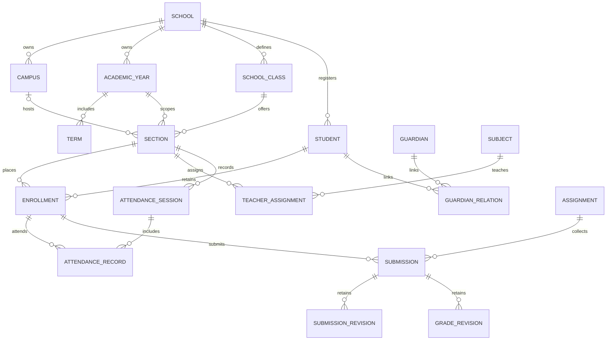

# Data Model

## Implemented relations

Student UUID and generated school-scoped STU code are permanent. The optional one-to-one User link supplies student portal identity. Student school/code/UUID cannot be changed through supported saves or queryset updates; registration is service-controlled.

Enrollment has its own UUID, Student, AcademicYear, Section, roll_number, status, prior Enrollment and registration date. Unique(student, year) prevents duplicate annual enrollment; unique(section, roll) is contextual. Placement/roll and completed outcomes are protected; enrollment history cannot be deleted through supported model/queryset paths. Promotion creates a new Enrollment and closes the old status atomically. Audited outcome events preserve actor/source/target context.

Section belongs to SchoolClass and AcademicYear, plus optional Campus. Null campus means schoolwide offering. Conditional uniqueness permits the same section label in different campuses while rejecting duplicates inside one scope. Normal Section.save validates school alignment; Term dates must fit its year. Joined foreign-key consistency is enforced by normal saves/services rather than cross-table SQL CHECK constraints.

Attendance uniqueness: section/date sessions and session/enrollment records. Submission uniqueness: assignment/enrollment; resubmission snapshots prior text, post-grade student edits are locked, and regrading retains GradeRevision.

PROTECT prevents deletion of referenced identity/history records. AuditEvent actor is SET_NULL and school PROTECT; private payload fields are rejected. Application guards do not constrain privileged raw SQL. Database-level operational protection remains a production gate.

Remaining schema: application decisions/documents, batch/conditional promotion records, attendance corrections, formal exam calendars and advanced financial schedules/refunds. Current assessment and finance tables are described below; conceptual future entities remain unimplemented.

## New implemented assessment schema

- Assessment → school, section, subject, academic year and optional term; opens/closes, attempt_limit and pass_percent define the pilot policy.
- Question → school/subject reusable bank row when assessment is null; attached questions are independent copies with kind, prompt, choices, key, points and order. Opened assessment questions are frozen.
- Attempt → Assessment + historical Enrollment + unique sequence number; draft/submitted/finalized/published lifecycle. Authoritative Answer marks remain separate from calculated raw_score/total_points, grade_label and snapshotted pass threshold/policy version.
- Answer → Attempt + Question; objective items scored automatically, manual items marked by authorized staff. Finalization rejects incomplete manual grading and freezes result rows.
- Historical report cards group published attempts by academic year and preserve enrollment section/roll, raw totals and policy version. Rich aggregate weighting/report export is not implemented.

## New implemented finance schema

- FeePlan → school + academic year + optional grade, Decimal amount and currency.
- Invoice → historical Enrollment + FeePlan; unique enrollment/plan prevents duplicate charges. Snapshot currency and immutable LedgerEntry charge/concession rows preserve billed amounts even if future plans differ.
- Payment → Invoice, positive Decimal amount/currency and school-scoped idempotency key; Receipt is one-to-one with immutable receipt code/time.
- LedgerEntry → Invoice, signed Decimal amount/kind, currency, optional Payment and one-to-one reversal_of. Charge is positive, payment/concession negative, reversal positive and linked to the original payment row. Reason is required for reversal; original payment/receipt stays intact.
- Exact balances are sums of row Decimals; no floating-point total or mutable balance column is a competing source of truth.

Invoices/payments/receipts/entries reject constructed-instance overwrites and ordinary queryset update/delete/bulk mutations. Services lock relevant rows and post ledger+audit atomically. SQLite verifies constraints; PostgreSQL concurrency behavior remains unverified. Full installment/refund/general-ledger entities remain planned.
