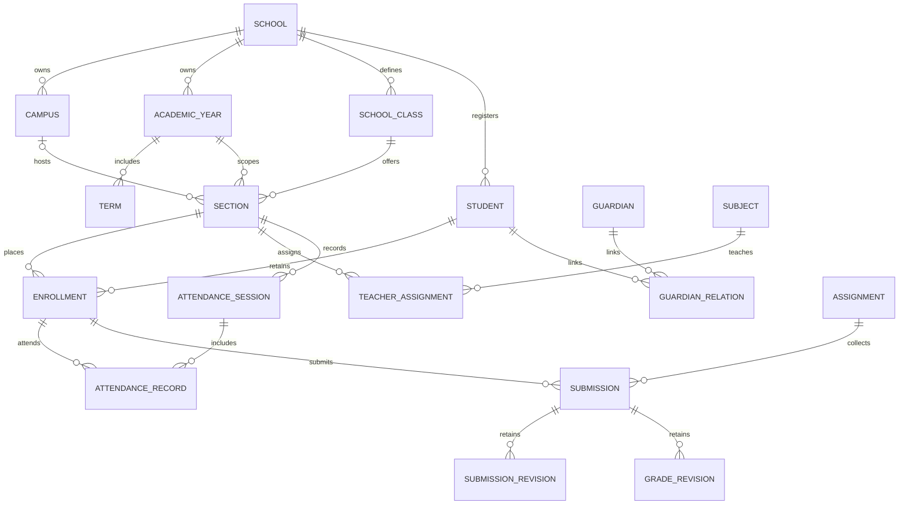

# Data Model

## Implemented relations

Student UUID and generated school-scoped STU code are permanent. The optional one-to-one User link supplies student portal identity. Student school/code/UUID cannot be changed through supported saves or queryset updates; registration is service-controlled.

Enrollment has its own UUID, Student, AcademicYear, Section, roll_number, status, prior Enrollment and registration date. Unique(student, year) prevents duplicate annual enrollment; unique(section, roll) is contextual. Placement/roll and completed outcomes are protected; enrollment history cannot be deleted through supported model/queryset paths. Promotion creates a new Enrollment and closes the old status atomically. Audited outcome events preserve actor/source/target context.

Section belongs to SchoolClass and AcademicYear, plus optional Campus. Null campus means schoolwide offering. Conditional uniqueness permits the same section label in different campuses while rejecting duplicates inside one scope. Normal Section.save validates school alignment; Term dates must fit its year. Joined foreign-key consistency is enforced by normal saves/services rather than cross-table SQL CHECK constraints.

Attendance uniqueness: section/date sessions and session/enrollment records. Submission uniqueness: assignment/enrollment; resubmission snapshots prior text, post-grade student edits are locked, and regrading retains GradeRevision.

PROTECT prevents deletion of referenced identity/history records. AuditEvent actor is SET_NULL and school PROTECT; private payload fields are rejected. Application guards do not constrain privileged raw SQL. Database-level operational protection remains a production gate.

Future schema: application decisions/documents, batch/conditional promotion records, attendance corrections, question/attempt/exam/report cards, and Decimal financial ledger. Do not treat conceptual entities as implemented tables.
